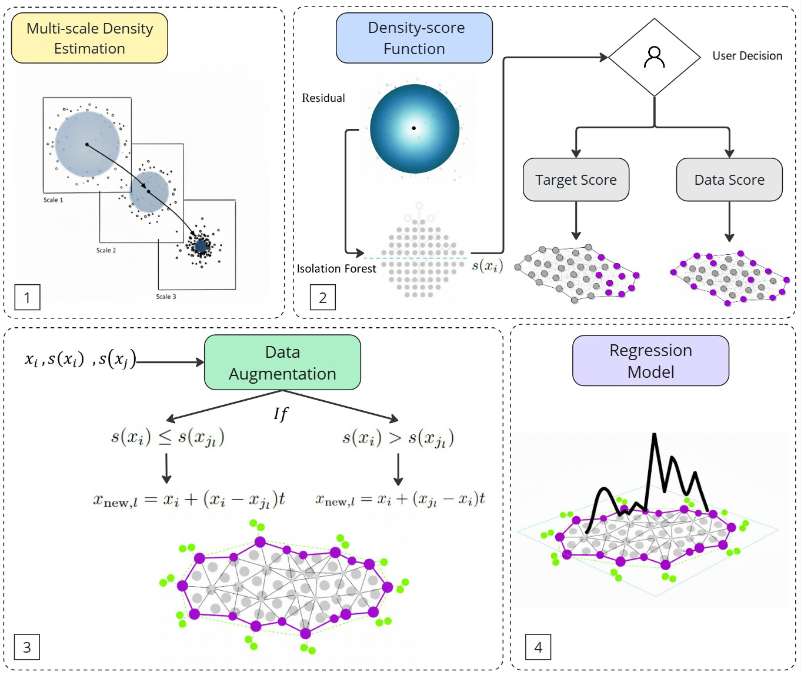
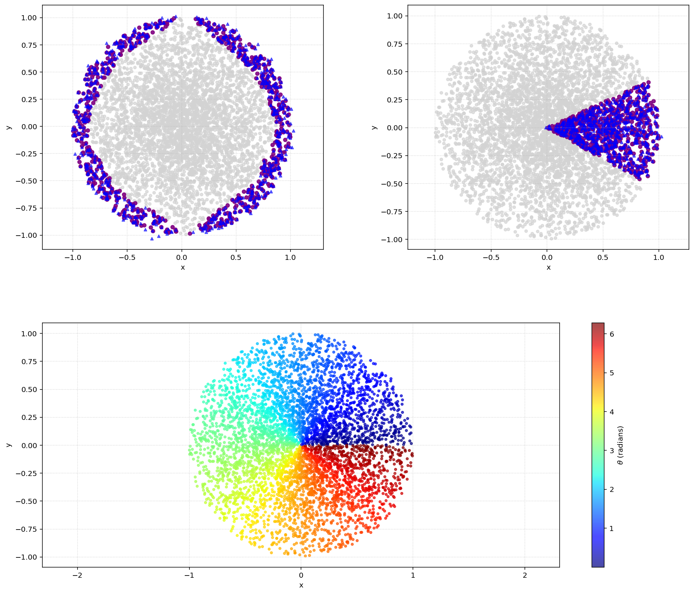

<div align="center">

# DGA

### Density-Guided Augmentation for Robust Time-Series Forecasting

Ben Hen · Neta Rabin
School of Industrial & Intelligent Systems Engineering, Tel-Aviv University


</div>

---

Most augmentation methods spread synthetic samples uniformly, which oversamples dense regions and neglects the sparse
or boundary regions where forecasts fail. DGA scores every training point with a multi-scale kernel reconstruction,
and then generates synthetic samples **outward from the dense area**, only where the score says support is missing.

The paper defines two score variants, Data Score and Target Score. **This repository implements the Target Score only**,
which flags regions where the regression function is hard to approximate.

<p align="center"></p>

## How it works

1. **Multi-scale density estimation.** A Laplacian Pyramid with Gaussian kernels, the bandwidth halved at every level, reconstructs the training set with leave-one-out kernels. The residuals of the best level (smallest leave-one-out error) are turned into one error vector per point.
2. **Target Score.** The pyramid regresses the target `y = f(X)`, so its residuals show where `f` is hard to approximate. An Isolation Forest ranks the error vectors, giving `s(x)`, where a low value means hard or sparse.
3. **Density-guided augmentation (Algorithm 2).** The bottom-`q` quantile of `s` forms `X_B`. From each point in `X_B`, new points are placed along the line to randomly chosen neighbours, stepping away from or toward them according to the scores. See below.
4. **Forecasting.** The same Laplacian Pyramid, now fit on the original plus synthetic windows, predicts the test windows.

<p align="center"></p>

*Algorithm 2 on synthetic 2D data. Top left: the unsupervised Data Score variant finds the boundary of `X` (not implemented here). Top right: for a target with a discontinuity along the positive x-axis, the Target Score finds that region and new points (blue) are added there. Bottom: the target `f(x) = θ`.*

### Algorithm 2: the sampling mechanism

For fixed `z_i`, `z_j` and `t` the synthetic point is deterministic. Randomness is therefore drawn explicitly, at two places:

1. **Neighbours.** For each `x_i` in `X_B`, `k~` of its `k` nearest neighbours are chosen uniformly, without replacement.
2. **Step length.** For every synthetic point a fresh, independent `t ~ Uniform(0, t_max)` is drawn, i.i.d. over `(i, l, j)`.

Given the draw, with `z = [x, f(x)]` and a low score meaning sparse:

```
s(x_i) <= s(x_j):   z_new = z_i + (z_i - z_j) t        (Eq. 10, away from the neighbour)
otherwise      :   z_new = z_i + (z_j - z_i) t        (Eq. 11, toward the sparser neighbour)
```

`t_max <= 1` keeps the new point inside the segment, `t_max > 1` extrapolates outward from the dense region. All
randomness comes from one seeded `numpy.random.Generator`, so a run is reproducible. The output has
`|X_B| · k~ · J` points. `tests/test_augment.py` checks that the `J` copies differ, that `t` lies in range, and that the direction rule holds.

## Repository layout

```
dga/
  lp.py         multi-scale Laplacian Pyramid, chunked kernels, leave-one-out
  scores.py     Target Score
  augment.py    Algorithm 2
  pipeline.py   score -> augment -> forecast
  tuning.py     validation-based hyper-parameter search
utils/
  data.py       Chickenpox loading, rolling windows, chronological split
  metrics.py    MAE, RMSE
scripts/run_chickenpox.py
tests/test_augment.py
docs/           figures
data/hungary_chickenpox.csv
```

### Paper → function

| Paper | Code |
|---|---|
| Algorithm 1, multi-scale approximation | `dga.lp.MultiScaleLP.fit` |
| Out-of-sample extension | `dga.lp.MultiScaleLP.predict` |
| Error vectors from the residuals | `dga.scores.error_vectors` |
| Target Score `s(x)` | `dga.scores.target_score` |
| Algorithm 2, density-guided augmentation | `dga.augment.density_guided_augmentation` |
| Augment, then forecast | `dga.pipeline.fit_predict`, `run_dga` |
| Validation-based tuning | `dga.tuning.tune`, `tune_and_run` |

## Quickstart

```bash
pip install -r requirements.txt
python scripts/run_chickenpox.py                              # 20 counties, tuned
python scripts/run_chickenpox.py --counties 0 5 13
python scripts/run_chickenpox.py --no-tune --J 5 --t-max 5    # fixed hyper-parameters
python -m pytest tests
```

Windows have length 8 (7 inputs, the next value is the target). The first 400 windows train and the rest test.
Per-county MAE and RMSE are written to `results/chickenpox_dga.csv`.

### On your own data

```python
import numpy as np
from dga import target_score, fit_predict
from utils import make_windows, split_xy

W = make_windows(series, window=8)                 # (n, 8): last column is the target
train, test = W[:400], W[400:]

X, y = split_xy(train)
s = target_score(X, y, seed=0)
y_pred, info = fit_predict(train, test, s, dict(q=0.05, k=5, k_tilde=3, J=5, t_max=5.0), seed=0)
```

Any array of shape `(n, m + 1)` whose last column is the target works the same way.

## Hyper-parameters

| | Meaning | Paper grid | Default grid here |
|---|---|---|---|
| `q` | fraction of points in `X_B` (bottom quantile of `s`) | 0.05, 0.10 | 0.05, 0.10 |
| `J` | synthetic points per (point, neighbour) | 1 to 5 | 1, 5 |
| `k~` | neighbours used per point | 1, 2, 3 | 1, 3 |
| `t_max` | upper end of the step length, `t ~ U(0, t_max)` | 1, 5, 10 | 5, 10 |
| `k` | neighbours searched (`k~ <= k`) | | 5 |

Pass a wider grid with `tune(train, grid={...})`.

## Notes

* **Tuning is leak free.** The last 20% of the training windows is held out. The score is computed on the fitting part only, so held-out windows never enter the fit that scores them.
* **Bandwidth.** `sigma_0` is estimated from the training windows (`eps_factor` times the largest nearest-neighbour distance), and halved per level. Settings live in `dga.lp.LPConfig`.

## Data

Weekly chickenpox cases in 20 Hungarian counties, from the UCI repository (Rozemberczki et al.). The CSV is included for convenience; check the dataset's license terms before redistributing it.

## Reproducibility

Every stochastic step (neighbour choice, step length, Isolation Forest, bandwidth sampling) is seeded. `--seeds 0 1 2` runs several seeds and reports the mean.
